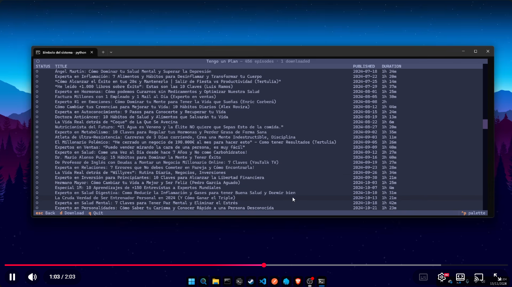

[Leer en español](README.es.md)

# Castor

A podcast client for the terminal. It is a project/experiment created for the purpose of practicing Python.

It can search for podcasts, subscribe to them, list their episodes and download them. There's a command line version and a text interface version (built with [Textual](https://textual.textualize.io/)), and both share the same code underneath.

It doesn't play audio. Pressing `p` on a downloaded episode opens it with whatever player the system uses by default.

## Trying it out

```
pip install requests feedparser rich platformdirs textual pytest
```

With the command line:

```
python project.py search "lex fridman"
python project.py subscribe <feed_url>
python project.py list
python project.py episodes "<podcast title>"
python project.py download <episode_id>
python project.py refresh
```

With the text interface:

```
python tui.py
```

Keys: `s` search, `r` refresh, `d` download, `p` play, `q` quit, `esc` go back.

## How it works (roughly)

- Podcasts are found through the iTunes Search API and episodes are read from the RSS feed with `feedparser`.
- Everything is stored in a single `library.json` in the user's data folder, so it's all still there after closing and reopening.
- The file is written safely, and if it ever gets corrupted it's backed up and the app starts from scratch.
- New episodes are detected by the RSS `guid`, not by title.

## Files

- `project.py`: the CLI and the main functions
- `tui.py`: the Textual interface
- `library.py`: reads and saves `library.json`
- `models.py`: the `Podcast` and `Episode` classes
- `exceptions.py`: custom errors
- `test_project.py`: tests (no internet needed)

## Tests

```
pytest test_project.py -v
```
## Demonstration video

[](https://youtu.be/2lhQ52Gpwnk)